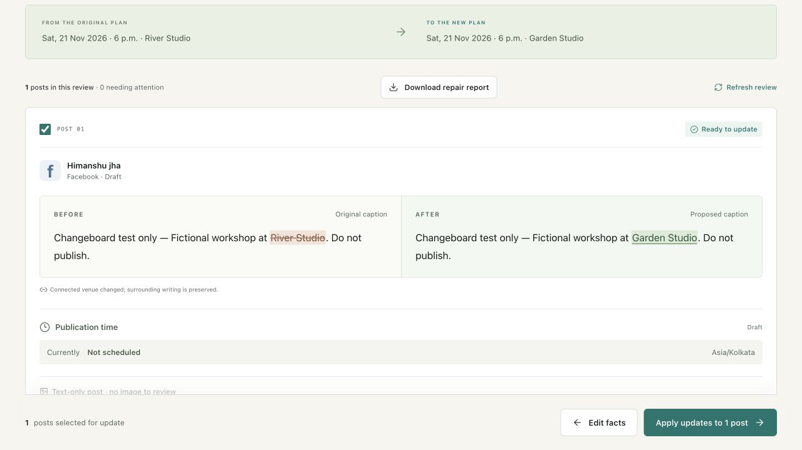

# Changeboard

Change one event fact. Repair the campaign you already wrote.

**[Open Changeboard](https://changeboard.52.202.25.181.sslip.io)** · [Privacy](https://changeboard.52.202.25.181.sslip.io/privacy) · [114-second live demo](https://changeboard.52.202.25.181.sslip.io/demo.html) · [Judge guide](https://changeboard.52.202.25.181.sslip.io/judge.html) · [Detailed walkthrough](docs/judge-walkthrough.md)

For workshop organizers and small venues: connect event facts to exact phrases in existing Buffer posts, review captions, images and publication times, then track individual outcomes. Confirmed phrases can be reused for the next change.

## What is verified live today

**Deployment checks — 8 November 2026:** the stable HTTPS app, `/privacy` and `/health` load without login. The fictional sample completes against hosted PostgreSQL, including a precise venue repair, a simulated source conflict, one verified sample outcome and two skipped posts. Records and the browser result survived an application-container restart. These are hosted sample results, not Buffer write results.

**Buffer evidence — 8 November 2026:** ordinary OAuth connected the existing account at this public URL, discovered its owned Facebook Page and completed an empty bounded post import. Six fresh live read receipts returned HTTP 200 without GraphQL errors. The encrypted connection and selected organization survived an application restart; fresh account/channel reads then succeeded. [Deployed OAuth evidence](outputs/deployed-oauth-evidence.json) records the checks. The six [October receipts](outputs/read-only-test-evidence.json) remain separate historical evidence.

**Real draft repair — 8 November 2026:** after explicit draft-only authorization, one fictional text draft was imported through the deployed app. Its exact venue phrase changed from **River Studio to Garden Studio**. The worker re-fetched before editing, verified Buffer’s readback and recorded one successful operation with one attempt. Buffer’s UI independently showed the new caption as **Unscheduled / Draft**, with zero queued and zero sent posts. The result and encrypted connection survived another application restart. [Live repair evidence](outputs/live-draft-repair-evidence.json) · [Repair report](outputs/live-draft-repair-report.md).

**Writes remain restricted to this one validated draft on the existing Page.** The installed receipt permits only text-caption edits on its exact channel/post IDs. Scheduled posts, other drafts, images and correction-draft creation remain blocked by that scope. The Meta grant was not expanded; draft editing worked under the existing connection. No post was scheduled, published or deleted.

The existing Lightsail VM stays running; it has no free-tier idle sleep. App restarts cause a brief interruption, and shared-host load can slow requests. Existing VM charges continue; this sprint created no new billable cloud resource or paid domain. See [operations and recovery](docs/deployment.md).

The sample needs no account and never calls Buffer. Its apply button says **Simulate updates**. See [deployment evidence](outputs/deployment-evidence.json) and [build-window provenance](docs/build-log.md) for dated checks and source revisions. Registration is confirmed and the captioned 114-second live demo is publicly playable. Final submission awaits explicit acceptance of the official terms; [the prepared handoff](outputs/submission-preflight.md) records the current status.

The [demo follow-up](outputs/recording-repair-evidence.json) performs Garden Studio → River Studio on the same validated draft. It succeeded in one attempt; fresh provider readback and Buffer’s UI retained Draft / Not scheduled, with zero queued or sent posts. This is a second application repair, not a new fixture or a broader write scope.



_Real Buffer draft containing fictional test content. This repair was applied and read back; it was never scheduled or published._

## Run locally

Node 22.14+ is supported. Install and run:

```sh
npm ci
npm run dev
```

Open http://127.0.0.1:4310. No account, secret, AI key or paid service is needed for the sample. PGlite (the PostgreSQL engine compiled to WebAssembly) persists development records in `work/data`. Run only one server per PGlite directory. It can take longer on a cold start. Restarting the application preserves campaigns and operation outcomes. `work/` is ignored and must never be published.

```sh
npm run typecheck
npm test -- --maxWorkers=1
npm run build
npm run db:migrate
```

Run database tests sequentially on memory-constrained hosts. The test suites distinguish deterministic logic, simulated Buffer responses, and local HTTP/SQL integration. None are live Buffer proof. The pinned install is recorded in package-lock.json.

## The useful journey

1. Try the sample; select the three existing posts and optionally the published announcement.
2. Confirm the original event facts, then each exact phrase. Manual association controls support occurrence selection.
3. Use the example event change or enter new date/time/venue/address facts.
4. Review complete caption comparisons. Confirm fixed publication context or choose a different schedule strategy. Review every image for this revision; preview the generated poster before accepting it.
5. Simulate a direct edit to a sample post. Refresh the preview to see it withheld. Select eligible operations and apply their immutable server change set.
6. Results preserve successful, skipped, failed, conflicting and uncertain operations. A skipped scheduled post keeps its schedule. A correction is a separately reviewed new draft.
7. Download the repair report from Review or Results. It separates unapplied proposals from recorded outcomes, includes caption/schedule comparisons and highlights skipped or uncertain work. Review its campaign content before sharing it.
8. Make another event change. Verified snapshots and exact association offsets are reused; unresolved posts retain their earlier baseline.

Sample mode never calls Buffer. The simulated external-edit control changes an independently stored source, so the same source-fingerprint check detects the conflict. AI extraction and OCR are unavailable; deterministic suggestions and manual confirmation are the implemented fallback. No unreviewed image is declared accurate.

## Buffer configuration

Copy `.env.example` to `.env` and configure `BUFFER_CLIENT_ID`, `BUFFER_CLIENT_SECRET` for a server/private client, `BUFFER_REDIRECT_URI`, and a random 32-byte base64 `TOKEN_ENCRYPTION_KEY`. Never send secrets in chat or browser storage. Buffer requires an exact registered **HTTPS** callback, including localhost. The callback path is `/api/auth/callback`.

The authorization flow requests `account:read posts:read posts:write offline_access`. Tokens stay server-side, encrypted with AES-256-GCM and owner-bound authenticated data. Refresh is serialized by a database row lock and saves both rotated tokens atomically. An ambiguous refresh requires reconnect. Ordinary OAuth users choose an accessible organization explicitly. All campaigns, operations and uploads are checked against their local owner; imported IDs alone confer no access.

The app records bounded, credential-free API receipts privately inside each connection record, with app-wide Retry-After cooldown. Live formats default to disabled. After authorized tests on owned channels, supply `LIVE_FORMAT_EVIDENCE_FILE` with entries of this shape:

```json
[
  {
    "key": "facebook:page:text",
    "verifiedAt": "<actual ISO timestamp>",
    "receiptId": "<actual receipt reference>"
  }
]
```

Do not populate this file from simulated results. The current partial test also requires the draft/channel/post `scope` documented in `docs/live-validation.md`; its receipt does not justify an unrestricted format record. See `docs/api-verification.md` for the observed contract. Live Instagram correction drafts are withheld until a separately reviewed correction image is implemented and tested; the text-only correction path supports verified Facebook Page channels.

## Architecture and invariants

One React frontend and Express API, PostgreSQL-compatible durable records, and a small database-backed worker. The worker runs in the server process and claims individual rows with leases. Production supports PostgreSQL via `DATABASE_URL`; no Redis, graph store or agent framework is needed.

- `src/domain`: validated facts, UTF-16 exact spans, deterministic text repair, Temporal calendar arithmetic, eligibility.
- `src/buffer`: current typed GraphQL adapter, narrow edit payloads, OAuth and token encryption.
- `src/server`: sessions/CSRF, account ownership, immutable change sets, persistence, retained media, queue and reconciliation.
- `src/client`: introduction and four workflow screens.
- `migrations/001_initial.sql`: initial durable schema. Campaign JSON preserves snapshots/bindings; immutable fact revisions and change sets have separate rows; operations are independently durable.

Before a write the worker re-fetches the remote post, compares relevant content/media/schedule/metadata and checks status, permissions and the ten-minute cutoff. Each selected operation is persisted before calling Buffer, then read back. Crashed leases become uncertain, never automatically pending. Lost create responses are not blindly retried. Remote simultaneous-edit races still exist: Buffer does not provide an atomic multi-post transaction or a remote exactly-once guarantee. A read before a write cannot eliminate a race in between.

Assets are PNGs at stable opaque `/media/:id` URLs served from the durable database. The small MVP deliberately uses same-origin immutable media instead of introducing a separate object-storage dependency. Live media requires a public HTTPS origin and remains retained before a potentially successful mutation, including uncertain outcomes. Public asset URLs have no login requirement because Buffer must fetch them. Only publish-intended images should be uploaded.

## Release and data behavior

See `docs/deployment.md`, `docs/privacy.md`, `CHECKLIST.md`, and `docs/verification.md`. The project-specific UI decisions are in `design.md`; the unchanged supplied specification is `PRD.md`.

The October 25 implementation predates the Buffer Commit build window. November 8 adds downloadable repair reports, a guided sample journey, connection-availability guidance, production configuration checks, isolated Docker/PostgreSQL hosting, credential-free read-receipt summaries and narrowly scoped draft-write evidence. Live testing also exposed the required explicit Facebook draft type, now included while retaining draft status. [Build provenance](docs/build-log.md) separates these additions; no earlier work is relabeled. The demo script and overview under `outputs/` describe the observed release and its read-only limit. No submission or live working video is claimed.
